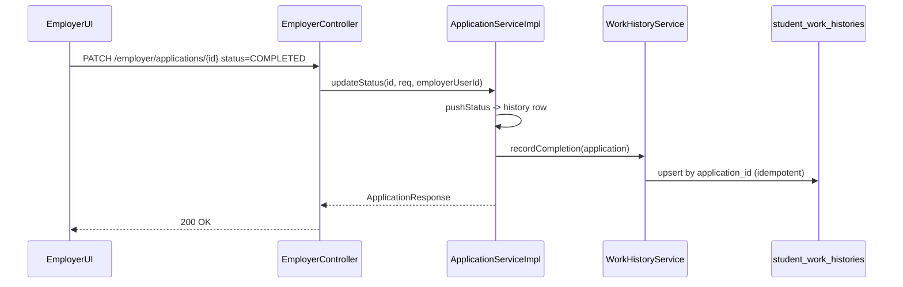

# Kinh nghiệm làm việc tự động cho ứng viên

## Muc tich

Khi NTD danh dau mot don ung tuyen sang `COMPLETED`, he thong tu dong ghi lai
mot muc kinh nghiem lam viec vao ho so sinh vien. NTD xem muc nay trong
trang chi tiet ung vien (`/employer/applications/{id}`).

Quyet dinh da chot (qua khoi nghi):
- Hien thi: them Card "Kinh nghiem lam viec" trong trang chi tiet ung vien cua NTD.
- Nguon du lieu: tu dong ghi khi don chuyen sang `COMPLETED`.
- Quyen xem: chi NTD da nhan don ung tuyen cua SV do + Admin.
- Luu truong: bang moi rieng `student_work_histories` (migration V8).

## Luu do dong du lieu

```
NTD bam "Danh dau hoan thanh"
        |
        v
PATCH /api/v1/employer/applications/{id}  status=COMPLETED
        |
        v
ApplicationServiceImpl.updateStatus -> pushStatus
        |
        v
WorkHistoryService.recordCompletion(application)
        |
        +--> INSERT student_work_histories (student_id, application_id, job_id,
        |    employer_id, job_title, company_name, position_name,
        |    started_at, completed_at, salary_type, salary_min, salary_max, note)
        |
        +--> push notification type=APPLICATION_STATUS (optional, same flow)
```



## Backend

### 1. Migration V8 (moi file)

`backend/src/main/resources/db/migration/V8__student_work_histories.sql`

Bang moi `student_work_histories`:
- `id` BIGINT PK auto increment
- `student_id` BIGINT FK -> student_profiles(user_id), ON DELETE CASCADE
- `application_id` BIGINT FK -> applications(id), ON DELETE CASCADE, UNIQUE
  (mot don chi ghi mot lan)
- `job_id` BIGINT FK -> job_posts(id), ON DELETE SET NULL
- `employer_id` BIGINT FK -> employer_profiles(user_id), ON DELETE SET NULL
- `job_title` VARCHAR(200) - snapshot ten tin tai thoi diem hoan thanh
- `company_name` VARCHAR(150) - snapshot ten NTD
- `position_name` VARCHAR(150) - snapshot chuc danh
- `started_at` DATETIME(6) NULL - thoi diem SV bat dau lam (lay tu timeline ACCEPTED)
- `completed_at` DATETIME(6) NOT NULL - thoi diem NTD danh dau hoan thanh
- `salary_type` VARCHAR(12) NULL, `salary_min` DECIMAL(12,0) NULL, `salary_max` DECIMAL(12,0) NULL
- `note` VARCHAR(500) NULL - ghi chu cua NTD luc chuyen trang thai
- `rating` TINYINT NULL - diem danh gia (filled sau khi SV/NTD danh gia)
- `created_at` DATETIME(6) NOT NULL DEFAULT CURRENT_TIMESTAMP(6)

Chi muc: `idx_swh_student (student_id)`, unique `uq_swh_application (application_id)`.

Khong sua V1-V7 (da apply) - tranh Flyway checksum mismatch.

### 2. Entity + repository + DTO (moi file)

- `backend/src/main/java/com/uniwork/entity/StudentWorkHistory.java`
- `backend/src/main/java/com/uniwork/repository/StudentWorkHistoryRepository.java`
  - `List<StudentWorkHistory> findByStudentUserIdOrderByCompletedAtDesc(Long studentUserId)`
  - `Optional<StudentWorkHistory> findByApplicationId(Long applicationId)`
  - `boolean existsByApplicationId(Long applicationId)`
- `backend/src/main/java/com/uniwork/dto/response/WorkHistoryResponse.java`
  - id, applicationId, jobId, jobTitle, companyName, positionName,
    startedAt, completedAt, salaryType, salaryMin, salaryMax, note, rating

### 3. Service

`backend/src/main/java/com/uniwork/service/WorkHistoryService.java` + `service/impl/WorkHistoryServiceImpl.java`

- `recordCompletion(Application app, String note)` - idempotent theo `application_id`
  - `started_at` = thoi diem chuyen sang `ACCEPTED` (tu `application_status_history`)
  - `completed_at` = `LocalDateTime.now()` luc chuyen COMPLETED
  - snapshot `job_title` / `company_name` / `position_name` / `salary_*` tu `JobPost`
  - `note` = ghi chu cua NTD
- `listForStudent(Long studentUserId)` - tra list cho SV xem trong ho so
- `listForApplication(String applicationId, Long employerUserId)` - quyen:
  - tim application -> lay `student_user_id`
  - cho phep neu `application.jobPost.employer.userId == employerUserId`
    (NTD so huu tin cua don) HOAC `existsByJobPostEmployerUserIdAndStudentUserId(employerUserId, studentUserId)`
    (NTD da tung nhan don cua SV do) - dung quy tac quyen doc CV hien tai
  - Admin xem qua endpoint rieng duoi `/api/v1/admin/...`

### 4. Ghi hook vao luong trang thai

`backend/src/main/java/com/uniwork/service/impl/ApplicationServiceImpl.java`
- inject `WorkHistoryService`
- trong `updateStatus`, sau `pushStatus(...)`: neu `newStatus` la `COMPLETED`
  va truoc do khong phai `COMPLETED` -> goi `workHistoryService.recordCompletion(application, note)`
- trong `pushStatus`, khi chuyen `ACCEPTED` -> ghi nhan thoi diem bat dau
  (doc lai tu `application_status_history` khi ghi COMPLETED, nen khong can sua them)

### 5. Controller + Security

- `EmployerController`:
  - `GET /api/v1/employer/applications/{applicationId}/work-history`
    -> `List<WorkHistoryResponse>` (chi NTD so huu tin / da nhan don)
  - `POST /api/v1/employer/applications/{id}/complete` - optional alias
    cua PATCH status, KHONG can neu frontend dung PATCH san co.
- `StudentController`:
  - `GET /api/v1/student/work-history` -> list kinh nghiem cua SV (SV xem trong ho so)
- `AdminController`:
  - `GET /api/v1/admin/work-history?studentId=` -> Admin tra cuu
- `SecurityConfig`: khong can sua - path `/api/v1/employer/**` da `hasRole("EMPLOYER")`,
  `/api/v1/student/**` da `hasRole("STUDENT")`, `/api/v1/admin/**` da `hasRole("ADMIN")`.
  Endpoint doc cua NTD phai kiem tra quyen o service (khong dua `targetUserId` client).

### 6. Mock API (frontend) - phai khop 100%

- `app/src/mocks/applications.ts` - them 3 muc work history cho app-007, app-008, app-009
  (de seed co du lieu cho UI) -> them truong moi vao type `Application` hoac
  tao file rieng `app/src/mocks/work-histories.ts`.
- `app/src/lib/mock/db.ts` - them `workHistories: []` vao `MockDatabase` + seed.
- `app/src/lib/mock/handlers/applications.ts` - them `workHistoryHandlers`:
  - `listForStudent(userId)`
  - `listForApplication(applicationId, employerProfileId)` - kiem tra quyen giong backend
- `app/src/lib/mock/router.ts` - route:
  - `GET /api/v1/employer/applications/{id}/work-history`
  - `GET /api/v1/student/work-history`
- `app/src/lib/mock/handlers/applications.ts` - trong `updateStatus`, khi chuyen
  `COMPLETED` -> ghi 1 muc `workHistory` vao db (tuong duong backend).

### 7. Seed SQL (deterministic)

- `app/scripts/generate-seed-sql.ts`:
  - doc `MOCK_WORK_HISTORIES` tu `app/src/mocks/work-histories.ts`
  - sinh file `V8__student_work_histories.sql` bang `INSERT ... SELECT` tu
    `applications` da seed (dung `slug` de join) de dam bao FK hop le
  - header ghi rõ "sinh tu dong boi pnpm seed:sql - khong sua tay"
- `app/src/mocks/time.ts` - moi timestamp dung `daysAgo` / `hoursAgo` (da co san)
  -> van deterministic.

## Frontend

### 1. Types + service + hooks

- `app/src/features/shared/types/index.ts`:
  ```ts
  export interface WorkHistory {
    id: string;
    applicationId: string | null;
    jobId: string | null;
    jobTitle: string;
    companyName: string;
    positionName: string;
    startedAt: string | null;
    completedAt: string;
    salaryType: string | null;
    salaryMin: number | null;
    salaryMax: number | null;
    note: string | null;
    rating: number | null;
  }
  ```
  them `workHistories: WorkHistory[]` vao `StudentProfile` (optional).
- `app/src/features/work-history/services/work-history.service.ts` (moi file)
  - `listForApplication(applicationId)` -> GET `/api/v1/employer/applications/{id}/work-history`
  - `listForStudent()` -> GET `/api/v1/student/work-history`
- `app/src/features/work-history/hooks/index.ts` (moi file)
  - `WORK_HISTORY_KEYS`
  - `useApplicationWorkHistory(applicationId)`
  - `useStudentWorkHistory()`
  - `useRecordWorkHistory()` (mutation, invalidate `WORK_HISTORY_KEYS.all`)

### 2. Trang chi tiet ung vien (NTD)

`app/src/pages/employer/application-detail.tsx`:
- them hook `useApplicationWorkHistory(id)`
- them Card "Kinh nghiem lam viec cua ung vien" trong cot trai (canh tren
  Card "Uy tin ung vien"), hien thi:
  - ten cong ty + chuc danh + vị trí (job title)
  - thoi gian: `formatDateVi(startedAt)` - `formatDateVi(completedAt)`
  - luong (nếu co) + ghi chu NTD + diem danh gia (neu co)
  - empty state: "Ung vien chua co kinh nghiem lam viec nao duoc ghi nhan."
- Card chi render khi NTD co quyen (backend da kiem tra, FE chi handle loi 403
  -> hien `ErrorState` nho).

### 3. Ho so sinh vien (SV xem lai)

`app/src/pages/student/profile.tsx`:
- them section "Kinh nghiem tu he thong ghi nhan" duoi Card "Kinh nghiem lam viec"
  (phan SV tu khai) - danh sach cac muc he thong tu dong tao, khong edit duoc.
- danh dau ro: "Do VieJob tu dong ghi khi nha tuyen dung xac nhan hoan thanh cong viec."

### 4. Realtime / notification (neu can)

Khi tao work history -> thong bao cho SV (type `APPLICATION_STATUS` da du dung
cho doi trang thai don, nen **khong can** type moi). Chi can invalidate
`PROFILE_KEYS.all` + `WORK_HISTORY_KEYS.all` trong
`app/src/features/notifications/hooks/invalidate.ts` khi type =
`APPLICATION_STATUS`.

### 5. Query keys

`app/src/features/notifications/hooks/invalidate.ts`:
- `APPLICATION_STATUS`: them `WORK_HISTORY_KEYS.all` vao danh sach invalidate.

## Verify

```bash
cd app
pnpm lint                 # 0 error, 0 warning
pnpm build                # tsc -b && vite build
pnpm verify:mock-api      # them case moi
pnpm seed:sql             # sinh lai V3 + V8
```

Backend (Docker):
```bash
docker compose -f docker-compose.dev.yml up --build
# Flyway tu chay V8
BASE_URL=http://localhost:8081/api/v1 bash backend/scripts/smoke-api.sh
```

Kiem chung UI that:
```bash
cd app
SMOKE_BASE_URL=http://localhost:8000 pnpm verify:full-app
```

## Test cases (verify-mock-api.ts + smoke-api.sh)

1. SV ung tuyen -> NTD chuyen ACCEPTED -> NTD chuyen COMPLETED
   -> `GET /employer/applications/{id}/work-history` tra 1 muc dung jobTitle/companyName.
2. Idempotent: goi lai PATCH status=COMPLETED -> van chi 1 muc (unique application_id).
3. NTD khong so huu tin do -> 403.
4. Admin xem duoc qua `/api/v1/admin/work-history`.
5. SV xem `/api/v1/student/work-history` thay doi khi don cua ho hoan thanh.
6. Mock API: cung 5 case tren tren in-memory db.
7. Flyway: `./dev.sh reset` xoa volume -> migrate V1..V8 khong loi checksum.

## Tai lieu

- `AGENTS.md` - them dong migration moi vao danh sach Flyway, them endpoint moi
  vao bang "Endpoint bo sung".
- `PRD.md` - them Feature moi (vd Feature 26) + BR (vd BR-06.18 ghi kinh nghiem
  tu dong) + dong trong Phu luc A (API map) + changelog.

## Files can tao / sua

Moi:
- `backend/src/main/resources/db/migration/V8__student_work_histories.sql`
- `backend/src/main/java/com/uniwork/entity/StudentWorkHistory.java`
- `backend/src/main/java/com/uniwork/repository/StudentWorkHistoryRepository.java`
- `backend/src/main/java/com/uniwork/dto/response/WorkHistoryResponse.java`
- `backend/src/main/java/com/uniwork/service/WorkHistoryService.java`
- `backend/src/main/java/com/uniwork/service/impl/WorkHistoryServiceImpl.java`
- `app/src/mocks/work-histories.ts`
- `app/src/features/work-history/services/work-history.service.ts`
- `app/src/features/work-history/hooks/index.ts`

Sua:
- `backend/.../service/impl/ApplicationServiceImpl.java` - hook ghi khi COMPLETED
- `backend/.../controller/EmployerController.java` - endpoint xem work history
- `backend/.../controller/StudentController.java` - endpoint SV xem work history
- `backend/.../controller/AdminController.java` - endpoint Admin tra cuu
- `backend/.../dto/response/StudentProfileResponse.java` - them `workHistories`
- `backend/.../service/impl/ProfileServiceImpl.java` - map `workHistories` vao ho so
- `app/src/features/shared/types/index.ts` - type `WorkHistory`
- `app/src/lib/mock/db.ts` - `workHistories` trong MockDatabase
- `app/src/lib/mock/handlers/applications.ts` - `workHistoryHandlers` + ghi khi COMPLETED
- `app/src/lib/mock/router.ts` - 2 route moi
- `app/src/features/notifications/hooks/invalidate.ts` - them key moi
- `app/src/pages/employer/application-detail.tsx` - Card kinh nghiem
- `app/src/pages/student/profile.tsx` - Section kinh nghiem tu he thong
- `app/scripts/generate-seed-sql.ts` - sinh V8
- `app/scripts/verify-mock-api.ts` - them test case
- `backend/scripts/smoke-api.sh` - them smoke case
- `AGENTS.md`, `PRD.md` - tai lieu
